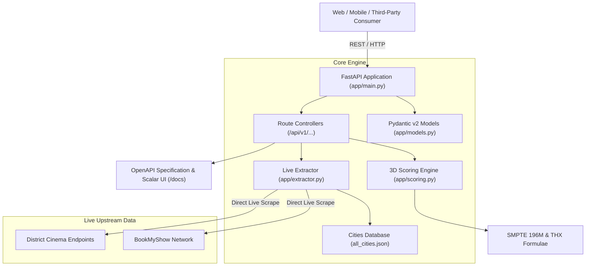

# CineSeat API 🍿📐

[](https://cineseat-api.antideploy.app)
[](https://cineseat-api.antideploy.app/docs)
[](https://www.python.org/)
[](LICENSE.md)
[](https://www.thx.com/)

> 🚀 **Live Interactive Documentation**: [https://cineseat-api.antideploy.app/docs](https://cineseat-api.antideploy.app/docs)  
> 🌐 **Live Base API**: [https://cineseat-api.antideploy.app](https://cineseat-api.antideploy.app)  
> 📦 **GitHub Repository**: [https://github.com/agnelfranciso/cineseat-api](https://github.com/agnelfranciso/cineseat-api)

---

> **High-Performance Cinema Intelligence & 3D Seating Geometry Engine**  
> Real-time movie showtimes, complete Indian cinema directory (2,167+ cities), and proprietary 3D auditorium seat quality scoring compliant with **SMPTE 196M** and **THX** optical viewing standards.

---

## 📑 Table of Contents

- [Overview](#-overview)
- [Inspiration & Background](#-inspiration--background)
- [Key Features](#-key-features)
- [Mathematical Seat Scoring Engine](#-mathematical-seat-scoring-engine)
- [System Architecture](#-system-architecture)
- [Quick Start](#-quick-start)
- [Docker Deployment](#-docker-deployment)
- [API Reference](#-api-reference)
  - [Cities & Geo-Location](#1-cities--geo-location)
  - [Movies & Catalogs](#2-movies--catalogs)
  - [Cinemas & Exhibitors](#3-cinemas--exhibitors)
  - [Showtimes & Sessions](#4-showtimes--sessions)
  - [Auditorium 3D Spatial Layout](#5-auditorium-3d-spatial-layout)
  - [SMPTE/THX Seat Recommendations](#6-smpte--thx-seat-recommendations)
  - [Alerts & Ancillary](#7-alerts--ancillary)
- [Running Automated Tests](#-running-automated-tests)
- [Project Structure](#-project-structure)
- [License](#-license)

---

## 🌟 Overview

**CineSeat API** is a standalone, production-ready REST service engineered to eliminate the guesswork of booking movie tickets. While ticketing platforms display seat grids, they never reveal:
- How severe the neck strain will be in the front rows.
- Whether a seat is pushed too far to the side aisle, causing trapezoidal keystone distortion.
- Which specific cluster of $N$ contiguous seats provides the reference viewing angle for a group.

CineSeat models the physical 3D auditorium geometry (screen dimensions, eye-level heights, stadium tier rises, seat coordinates) and calculates optical viewing metrics according to global cinematic industry guidelines.

---

## 💡 Inspiration & Background

The concept for CineSeat API was inspired after discovering **seats.movie**, created by developer **Sunith V S** (@sunithvs), who demonstrated how valuable 3D auditorium previews can be for moviegoers. 

While that project showcased the consumer side of the problem, it highlighted a major void in the developer ecosystem: **there was no open, developer-accessible public solution for this.** 

Whenever engineers build movie dashboards, showtime aggregators, or indie ticket-booking platforms, they face two fundamental challenges:
1. **Accurate Pan-India Cinema Listings**: Getting structured, real-time cinema and showtimes metadata across Indian cities.
2. **Empirical Seat Evaluation**: Mathematically determining which seats provide genuine optical comfort rather than leaving users to guess from a flat 2D map.

CineSeat API was built from the ground up as an independent, open-source RESTful platform to solve this exact dilemma—empowering any developer to integrate pan-India showtimes intelligence and 3D spatial seat recommendations directly into their apps.

---

## 🚀 Key Features

- 📍 **Full Indian Geo-Directory**: Search across **2,167+ verified Indian cities and towns** with tier-1 metro flags and Haversine GPS geo-proximity lookup.
- 🎬 **Real-Time Movie Discovery**: Live movie listings with verified high-resolution portrait posters, backdrop banners, audio languages, censor certificates, runtimes, and genre tags.
- 🏛️ **Exhibitor & Screen Intelligence**: Cinema profiles across all major chains (PVR INOX, Cinepolis, Miraj, MovieMax, etc.) with GPS coordinates and format badges (`IMAX`, `4DX`, `DOLBY_ATMOS`, `ICE`, `Laser`).
- 🎟️ **Live Showtimes & Occupancy**: Schedules grouped by movie or cinema with real-time remaining seat counts, price brackets, and occupancy percentages.
- 📐 **Auditorium 3D Spatial Geometry**: Reconstructed hall maps providing true spatial $(x, y, z)$ coordinates in meters for every seat, physical screen dimensions, and pricing tiers (`Recliner`, `Prime`, `Classic`).
- 🏆 **SMPTE & THX Cinema Seat Scoring Engine**:
  - **Horizontal Field of View (FOV)** evaluation ($30^\circ$ minimum, $45^\circ$ optimal SMPTE reference).
  - **Off-Axis Displacement** penalty ($< 15^\circ$ reference sweet spot).
  - **Vertical Neck Tilt** compliance ($\le 15^\circ$ maximum THX standard to avoid cervical fatigue).
  - **Dynamic Contiguity Optimizer**: Finds the highest-ranked uninterrupted block of $N$ seats together ($1 \le N \le 10$).
- 🛡️ **Pydantic v2 Type Safety**: Strict validation, typed OpenAPI 3.1 schemas, and interactive Scalar documentation at `/docs`.

---

## 📐 Mathematical Seat Scoring Engine

The scoring engine evaluates each seat $S$ using its 3D coordinates $(x_s, y_s, z_s)$ relative to the cinema screen center $(0, y_c, 0)$ and width $W$.

```
                        Screen (Width = W)
               [==================================]
                               |
                               | z (Distance)
                               |
                 Seat S (x, y, z)
                       \       |       /
                        \  FOV | θ    /
                         \     |     /
                          \    |    /
```

### 1. Horizontal Field of View (FOV)
Calculates the subtended horizontal angle from the viewer's eye to both edges of the screen:

$$\theta_{\text{FOV}} = \arctan\left(\frac{W/2 - x_s}{z_s}\right) - \arctan\left(\frac{-W/2 - x_s}{z_s}\right)$$

- **SMPTE 196M Standard**: Minimum $\ge 30^\circ$, Optimal reference $45^\circ$.
- **THX Guideline**: Recommends $\ge 36^\circ$ for immersion.

### 2. Off-Axis Displacement Angle
Calculates horizontal eccentricity from the perpendicular center-line of the screen:

$$\theta_{\text{axis}} = \arctan\left(\frac{|x_s|}{z_s}\right)$$

- Center aisle seats have $\theta_{\text{axis}} \approx 0^\circ$.
- Severe keystone distortion occurs when $\theta_{\text{axis}} > 20^\circ$.

### 3. Vertical Neck Tilt Angle
Calculates the elevation angle from the seated eye height to the vertical center of the screen:

$$\phi_{\text{neck}} = \arctan\left(\frac{y_c - (y_s + h_{\text{eye}})}{\sqrt{x_s^2 + z_s^2}}\right)$$

- **THX Maximum**: $\phi_{\text{neck}} \le 15^\circ$. Exceeding $15^\circ$ causes acute neck fatigue.

### 4. Composite Quality Score
The final seat score $Q \in [0, 100]$ is computed as a weighted harmonic blend:

$$Q = 100 \times \left(0.42 \cdot S_{\text{FOV}} + 0.38 \cdot S_{\text{axis}} + 0.20 \cdot S_{\text{neck}}\right)$$

| Score Range | Quality Band | Seating Assessment |
| :--- | :--- | :--- |
| **88 – 100** | `Exceptional` | **Auditorium Sweet Spot** — THX reference viewing angle & zero neck strain |
| **75 – 87** | `Great` | **Prime Experience** — Balanced eye-level immersion with high FOV |
| **60 – 74** | `Good` | **Comfortable View** — Slight lateral offset but solid screen visibility |
| **45 – 59** | `Fair` | **Acceptable** — Noticeable side angle or higher elevation |
| **0 – 44** | `Poor` | **Compromised** — Front row neck strain or extreme peripheral distortion |

---

## 🏗️ System Architecture



---

## ⚡ Quick Start

### Prerequisites
- Python 3.10+ (tested up to Python 3.12)
- `pip` package manager

### 1. Clone & Setup
```bash
git clone https://github.com/your-username/cineseat-api.git
cd cineseat-api
```

### 2. Create Virtual Environment
```bash
python -m venv .venv

# On Linux / macOS:
source .venv/bin/activate

# On Windows (PowerShell):
.venv\Scripts\Activate.ps1
```

### 3. Install Dependencies
```bash
pip install -r requirements.txt
```

### 4. Run the API Server
```bash
python run.py
```

The service will start at **`http://127.0.0.1:8000`**.  

### 🌐 Live Cloud Deployment & Interactive Documentation
- **Interactive Scalar API Docs**: [https://cineseat-api.antideploy.app/docs](https://cineseat-api.antideploy.app/docs)
- **Live Cloud API Endpoint**: [https://cineseat-api.antideploy.app](https://cineseat-api.antideploy.app)
- **Live OpenAPI 3.1 Specification**: [https://cineseat-api.antideploy.app/openapi.json](https://cineseat-api.antideploy.app/openapi.json)
- **Health & Readiness Check**: [https://cineseat-api.antideploy.app/health](https://cineseat-api.antideploy.app/health)
- **Local Dev Scalar UI**: [http://127.0.0.1:8000/docs](http://127.0.0.1:8000/docs)

---

## 🐳 Docker Deployment

A lightweight Dockerfile based on `python:3.12-slim` is provided with built-in healthchecks.

### Build Container
```bash
docker build -t cineseat-api:latest .
```

### Run Container
```bash
docker run -d \
  --name cineseat \
  -p 8000:8000 \
  -e PORT=8000 \
  --restart unless-stopped \
  cineseat-api:latest
```

Verify container status:
```bash
curl http://localhost:8000/health
```

---

## 📡 API Reference

All successful responses return HTTP `200 OK` with standard JSON envelopes.

### 1. Cities & Geo-Location

#### List All Cities
```http
GET /api/v1/cities?query=thrissur&metro_only=false&limit=10&offset=0
```
**Response:**
```json
{
  "success": true,
  "timestamp": "2026-11-17T08:00:00Z",
  "count": 1,
  "cities": [
    {
      "slug": "thrissur",
      "name": "Thrissur",
      "state": "Kerala",
      "is_metro": false,
      "latitude": 10.5276,
      "longitude": 76.2144
    }
  ]
}
```

#### Find Nearest City by GPS
```http
GET /api/v1/cities/nearest?lat=10.5276&lng=76.2144
```

---

### 2. Movies & Catalogs

#### List Current Movies in City
```http
GET /api/v1/movies?city=thrissur
```
**Response:**
```json
{
  "success": true,
  "timestamp": "2026-11-17T08:00:00Z",
  "city": "thrissur",
  "count": 12,
  "movies": [
    {
      "id": "ET233181",
      "title": "BTS World Tour: Arirang In Kaohsiung",
      "slug": "bts-world-tour-et233181",
      "genres": ["Concert", "Music"],
      "primary_language": "Korean",
      "languages": ["Korean"],
      "censor_rating": "U",
      "rating": "9.2/10",
      "runtime_minutes": 165,
      "poster_url": "https://assets-in.bmscdn.com/iedb/movies/images/mobile/thumbnail/xlarge/et00233181.jpg",
      "backdrop_url": "https://assets-in.bmscdn.com/iedb/movies/images/mobile/listing/xxlarge/et00233181.jpg"
    }
  ]
}
```

---

### 3. Cinemas & Exhibitors

#### List Cinemas in City
```http
GET /api/v1/cinemas?city=thrissur
```
**Response:**
```json
{
  "success": true,
  "timestamp": "2026-11-17T08:00:00Z",
  "city": "thrissur",
  "count": 9,
  "cinemas": [
    {
      "id": "0",
      "name": "INOX Sobha City Mall, Puzhakkal, Thrissur",
      "chain": "PVR INOX",
      "city": "thrissur",
      "address": "2nd Floor, Sobha City Mall, Puzhakkal, Thrissur 680553",
      "latitude": 10.550423,
      "longitude": 76.183839,
      "supported_formats": ["2D", "DOLBY_ATMOS"]
    }
  ]
}
```

---

### 4. Showtimes & Sessions

#### Showtimes Grouped by Movie
```http
GET /api/v1/showtimes/by-movie/ET233181?city=thrissur&date=today
```

#### Showtimes Grouped by Cinema
```http
GET /api/v1/showtimes/by-cinema/0?city=thrissur&date=today
```

---

### 5. Auditorium 3D Spatial Layout

#### Get Full Seat Map with 3D Spatial Coordinates
```http
GET /api/v1/auditorium/layout/{cinema_id}/{session_id}?city=thrissur
```
**Response:**
```json
{
  "success": true,
  "timestamp": "2026-11-17T08:00:00Z",
  "cinema_id": "0",
  "cinema_name": "INOX Sobha City Mall",
  "session_id": "115430",
  "screen_name": "Audi 1",
  "geometry": {
    "screen_width_meters": 14.0,
    "screen_height_meters": 5.86,
    "row_count": 15,
    "column_count": 16,
    "first_row_distance_m": 5.5,
    "back_row_distance_m": 20.2
  },
  "capacity": 240,
  "available_seats": 142,
  "reserved_seats": 98,
  "rows": [
    {
      "row_id": "8",
      "label": "H",
      "seat_count": 16,
      "seats": [
        {
          "id": "H8",
          "row": "H",
          "column": 8,
          "label": "H8",
          "category": "Prime",
          "price": 280.0,
          "status": "available",
          "sellable": true,
          "coordinates_3d": {
            "x": -0.28,
            "y": 2.25,
            "z": 12.85
          }
        }
      ]
    }
  ]
}
```

---

### 6. SMPTE / THX Seat Recommendations

#### Find Top Contiguous Seat Blocks
```http
GET /api/v1/recommendations/best-seats?movie_id=ET233181&city=thrissur&seats_count=2&prefer_center=true&avoid_front_rows=true&top_k=3
```
**Response:**
```json
{
  "success": true,
  "timestamp": "2026-11-17T08:00:00Z",
  "movie_id": "ET233181",
  "city": "thrissur",
  "date": "today",
  "seats_requested": 2,
  "shows_analyzed": 18,
  "total_options_found": 18,
  "recommendations": [
    {
      "rank": 1,
      "score": 97,
      "band": "Exceptional",
      "verdict": "Best in auditorium — THX reference sweet spot",
      "seats": ["H8", "H9"],
      "row": "H",
      "category": "Prime",
      "total_price": 560.0,
      "metrics": {
        "horizontal_fov_deg": 44.8,
        "off_axis_deg": 1.2,
        "vertical_tilt_deg": 6.4,
        "distance_to_screen_m": 12.85,
        "viewing_ratio": 1.15
      },
      "booking_url": "https://in.bookmyshow.com/buytickets/..."
    }
  ]
}
```

---

### 7. Alerts & Ancillary

#### Subscribe to Seat Drop Alerts
```http
POST /api/v1/alerts/subscribe
Content-Type: application/json

{
  "email": "user@example.com",
  "movie_id": "ET233181",
  "city": "thrissur",
  "date": "20261118"
}
```

---

## 🧪 Running Automated Tests

A comprehensive unit and integration test suite is included under `tests/test_api.py`.

Run tests with `unittest`:
```bash
python -m unittest tests/test_api.py -v
```

Or with `pytest`:
```bash
pytest tests/ -v
```

---

## 📁 Project Structure

```
.
├── app/
│   ├── __init__.py          # Application package initialization
│   ├── main.py              # FastAPI application, routing, and CORS configuration
│   ├── models.py            # Pydantic v2 schemas and validation models
│   ├── scoring.py           # SMPTE 196M & THX 3D auditorium seat scoring engine
│   ├── extractor.py         # Live cinema metadata and showtimes provider
│   └── all_cities.json      # Complete database of 2,167 Indian cities
├── tests/
│   └── test_api.py          # 13 automated endpoint verification tests
├── .dockerignore            # Docker build ignore rules
├── .env.example             # Example environment variable configuration
├── .gitignore               # Standard Python Git ignore rules
├── Dockerfile               # Multi-stage production container build
├── requirements.txt         # Pinned production dependencies
├── run.py                   # High-performance server bootstrap runner
└── README.md                # Comprehensive documentation
```

---

## 💡 Acknowledgements & Inspiration

This project was inspired by the cinema seating visualization and crowd-booking exploration pioneered by indie developer **Sunith V.S.** (widely known in the Indian tech ecosystem as *truevibecoder*). Observing the real-world demand for transparent seat quality metrics, **CineSeat API** was designed from the ground up as an independent, clean-room, standards-compliant RESTful backend service. It implements first-principles 3D auditorium spatial geometry, SMPTE 196M ($FOV \ge 30^\circ$, optimal $45^\circ$) and THX ($\phi_{\text{neck}} \le 15^\circ$, off-axis $< 15^\circ$) optical metrics, and typed OpenAPI 3.1 specifications.

> **Disclaimer**: CineSeat API is an independent open-source educational project. It is not affiliated with, maintained by, or endorsed by Sunith V.S., BookMyShow, or District.

---

## 🚦 Rate Limiting & Demo Guard

- **GitHub & Self-Hosted**: The codebase is **unrestricted with 0 artificial limits**. Self-hosted deployments and Docker runs have no rate limiting by default.
- **Hosted Public Demo**: The live hosted demo has an optional rate limiter (`LIVE_DEMO_MODE=true`, 60 req/min per IP) to prevent automated third-party commercial scraping while allowing interactive web testing via Scalar.
- **Documentation & Health**: The interactive Scalar reference (`/docs`) and health probes (`/health`) are always exempt from rate limiting.

---

## 💡 Acknowledgements & Inspiration

This project was inspired by the cinema seating visualization and crowd-booking exploration pioneered by indie developer **Sunith V.S.** (widely known in the Indian tech ecosystem as *truevibecoder*). Observing the real-world demand for transparent seat quality metrics, **CineSeat API** was designed from the ground up as an independent, clean-room, standards-compliant RESTful backend service. It implements first-principles 3D auditorium spatial geometry, SMPTE 196M ($FOV \ge 30^\circ$, optimal $45^\circ$) and THX ($\phi_{\text{neck}} \le 15^\circ$, off-axis $< 15^\circ$) optical metrics, and typed OpenAPI 3.1 specifications.

> **Disclaimer**: CineSeat API is an independent open-source educational project. It is not affiliated with, maintained by, or endorsed by Sunith V.S., BookMyShow, or District.

---

## 🚦 Rate Limiting & Demo Guard

- **GitHub & Self-Hosted**: The codebase is **unrestricted with 0 artificial limits**. Self-hosted deployments and Docker runs have no rate limiting by default.
- **Hosted Public Demo**: The live hosted demo has an optional rate limiter (`LIVE_DEMO_MODE=true`, 60 req/min per IP) to prevent automated third-party commercial scraping while allowing interactive web testing via Scalar.
- **Documentation & Health**: The interactive Scalar reference (`/docs`) and health probes (`/health`) are always exempt from rate limiting.

---

## 📄 License

This project is licensed under the MIT License — see the [LICENSE.md](LICENSE.md) file for full legal terms and disclaimers.
